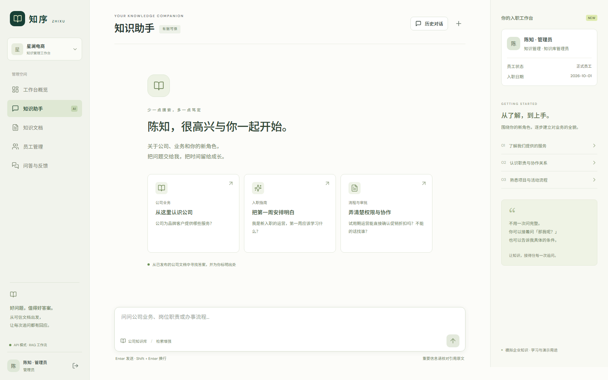
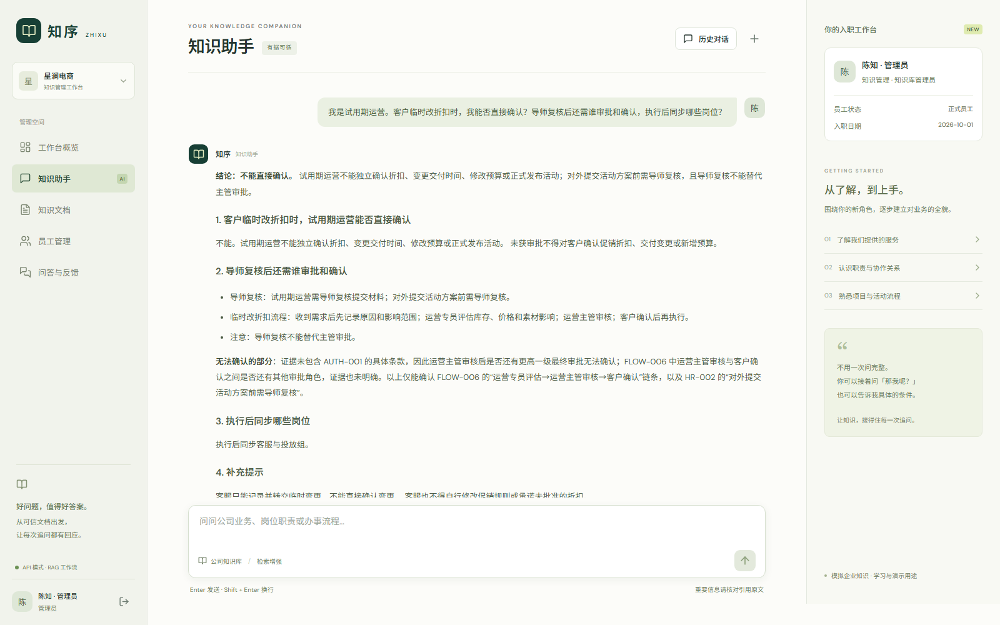
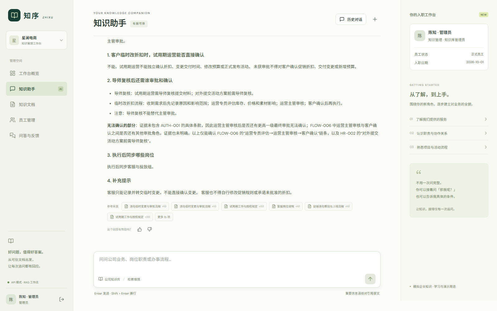
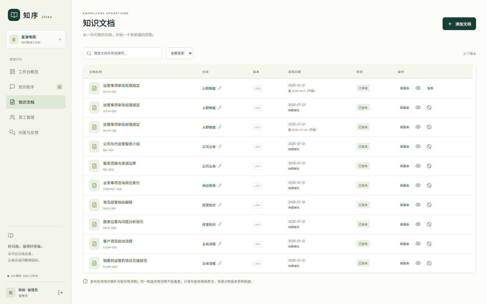
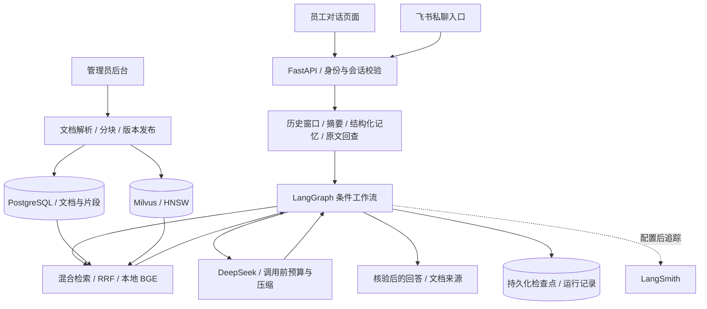
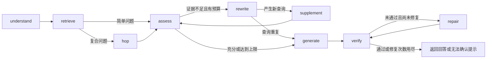

<h1 align="center">知序 · 新员工业务知识助手</h1>

<p align="center">面向员工入职与制度查询的自适应 RAG，结合混合检索、多跳补检、双阶段反思与会话记忆，回答附带文档来源。</p>

<p align="center"><strong>Vue 3 · FastAPI · LangGraph · PostgreSQL · Milvus · DeepSeek · 本地 BGE</strong></p>

## 界面预览



<details>
<summary>展开查看实际问答、来源卡片与知识文档管理</summary>

| 页面 | 展示内容 |
|---|---|
| 知识问答 | 试用期条件、审批步骤与无法确认的证据缺口 |
| 引用来源 | 回答底部的文档版本与来源卡片 |
| 知识管理 | 文档分类、版本、适用日期、发布与停用状态 |







</details>

截图来自本地 live 应用与模拟业务资料；当前业务库状态可能与冻结评测语料不同。重新截取可运行 `node scripts/capture-showcase.mjs`，需前后端服务已启动、Playwright 浏览器就绪，且本地已配置管理员密码。

## 项目解决什么问题

新员工查询业务与制度时，资料分散在岗位说明、试用期规定和审批流程中；单次检索容易遗漏跨文档依据，连续追问容易丢失身份条件，新旧制度也容易混用。知序围绕这些问题设计可追踪、可恢复的问答流程。公司与制度资料均为自行设计的模拟数据。

| 业务问题 | 示例 | 处理方式 |
|---|---|---|
| 资料分散，难以定位 | 公司提供哪些服务？账号问题找谁？ | 自然语言检索、来源卡片与原文查看 |
| 跨文档依据遗漏 | 试用期能准备材料吗？临时改折扣又怎么审批？ | 问题拆分、文档引用补检、证据完整性评估 |
| 连续追问遗忘条件 | 先说“我是试用期运营”，多轮后问“那我能直接确认吗？” | 近期窗口、结构化条件、摘要与历史原文回查 |
| 新旧制度混用 | 6月30日和7月1日的材料提交要求是否相同？ | 按查询日期匹配有效文档版本 |
| 缺少依据仍给出确定答案 | 询问文档未提供的年假天数或折扣额度 | 证据检查、有限重检索、回答核验与无法确认提示 |

## 核心能力

| 模块 | 已实现能力 | 代码入口 |
|---|---|---|
| 混合检索 | BM25L＋向量召回，RRF 融合，本地 BGE 重排 | [retrieval.py](backend/app/retrieval.py)、[reranker.py](backend/app/reranker.py) |
| 结构感知分块 | 标题结构＋字符长度控制，保存章节和所属文档版本 | [knowledge.py](backend/app/knowledge.py) |
| 动态检索与多跳 | 按问题复杂度拆分查询，根据证据中的文档引用补齐第二跳 | [workflow.py](backend/app/workflow.py) |
| 检索反思 | 检查完整性、支持性、身份条件与版本；不足时改写查询，最多补检2轮 | [workflow.py](backend/app/workflow.py) |
| 回答核验 | 检查回答依据与引用，最多修复1次并再次核验 | [workflow.py](backend/app/workflow.py) |
| 压缩与记忆 | 可配置16k总预算、三级压缩、滑动窗口、动态摘要与原文回查 | [compression.py](backend/app/compression.py)、[memory.py](backend/app/memory.py) |
| 持久化与恢复 | LangGraph 检查点、请求幂等、数据库租约与失败重试 | [service.py](backend/app/service.py)、[main.py](backend/app/main.py) |
| 知识管理 | 上传、预览、草稿编辑、发布、停用、版本替换与分类维护 | [knowledge.py](backend/app/knowledge.py)、[Admin.vue](frontend/src/Admin.vue) |
| 账号与反馈 | 员工会话隔离，管理员维护账号、查看问答与反馈 | [main.py](backend/app/main.py)、[db.py](backend/app/db.py) |
| 可观测性 | 节点事件、重试轮次、压缩记录、API 用量；可配置 LangSmith | [providers.py](backend/app/providers.py)、[Admin.vue](frontend/src/Admin.vue) |
| 停止生成 | 输入框右下角切换停止按钮，取消模型连接并阻止后续节点执行 | [Chat.vue](frontend/src/Chat.vue)、[cancellation.py](backend/app/cancellation.py) |
| 飞书入口 | 私聊文本、员工绑定、来源回复与会话复用；需应用凭据联调 | [feishu.py](backend/app/feishu.py) |

## 系统架构



### LangGraph 工作流



| 节点 | 职责 | 限制与退出条件 |
|---|---|---|
| `understand` | 结合身份、历史理解问题，形成独立查询、子问题与日期 | 最多3个子查询 |
| `retrieve` | 首轮混合召回与重排 | 每个查询最终最多6个片段，合并去重最多14个 |
| `hop` | 根据证据引用查找缺失文档 | 两跳包含首轮；额外补检最多1次 |
| `assess` | 检查证据完整性、支持性、条件与版本 | 不足时改写；达到预算时保留证据缺口 |
| `rewrite` | 结合缺口、身份、日期和历史查询生成新查询 | 重复查询提前停止 |
| `supplement` | 执行新查询并合并证据，再次评估 | 默认最多2轮；整个请求最多6次检索调用 |
| `generate` | 生成有出处的回答，说明未解决的缺口 | 不把未找到的条款补成事实 |
| `verify` | 核验回答依据、引用编号与引用缺失 | 未通过时可进入修复 |
| `repair` | 修正回答并再次核验 | 最多1次，仍不通过则保守回复 |

以上为正常完整流程。查询改写重试、网络技术重试与 JSON 格式重试分别计数。反思通过运行时评估与纠错实现，不依赖开启模型思考模式，不涉及训练专用反思模型。

## 检索与索引设计

| 环节 | 当前方案 | 参数与取舍 |
|---|---|---|
| 分块 | 标题结构＋字符长度控制 | 2200字符软目标，保留整行，无重叠；记录标题与章节 |
| 片段关联 | `id`＋`document_id` | 片段 ID 关联具体文档版本，正文与元数据存 PostgreSQL |
| 稀疏召回 | BM25L＋中文分词 | 岗位名称、制度编号与业务关键词；每路最多12条 |
| 稠密召回 | Qwen3-Embedding-0.6B＋Milvus | API 嵌入、1024维；每路最多12条 |
| ANN 索引 | HNSW / COSINE | `M=16`、`efConstruction=128`、查询 `ef=64` |
| 融合 | RRF | `k=60`，按排名融合，最多16条候选 |
| 重排 | 本地 BGE-reranker-v2-m3 | CPU 动态 int8、批次4、最大长度512，最终最多6条 |
| 适用性过滤 | 发布状态＋有效日期 | 有效期为 `[生效日期, 失效日期)` |
| 规模取舍 | 应用侧 BM25 | 当前读取可见片段构建，适用于本地小型知识库，后续可增加缓存 |

HNSW 近邻图用于加速向量搜索；业务多跳沿文档引用补充依据，两者独立。当前未证明 HNSW 优于其他 ANN 算法，随机向量索引实验也不能代替业务检索评测。

## 上下文压缩与记忆管理

| 机制 | 当前配置与行为 | 目的 |
|---|---|---|
| 总预算 | 默认16000 Token，预留输出2400和安全余量800，输入预算12800 | 控制完整请求体积，参数可配置 |
| 近期窗口 | 默认最近4轮 | 保留连续追问上下文 |
| 结构化记忆 | 问题对象、岗位、试用期、日期等 | 降低条件遗漏与对象混淆 |
| 动态摘要 | 存在窗口外旧消息，且未总结内容与旧摘要估算量达到记忆子预算70%时触发；子预算默认4000 | 压缩较早历史 |
| 原文回查 | 按关键词与指代规则回查本会话历史用户消息，最多3条 | 补充摘要可能遗漏的依据 |
| 持久化 | `conversations.summary / summary_until / memory`；原文在 `messages` | 保留摘要覆盖位置和原始消息 |

| 压缩级别 | 输入预算利用率 | 处理方式 |
|---|---|---|
| 轻量压缩 | 达到50% | 完整段落去重，清理检索分数等内部元数据 |
| 中度压缩 | 处理后仍达到70% | 提取相关完整条款，窗口由4轮收紧至2轮，移出消息转为抽取式摘要 |
| `auto-compact` | 处理后仍超过85% | 窗口收紧至1轮，进一步抽取历史、摘要与证据 |
| 预算兜底 | 必要内容仍超预算 | 明确停止并提示调整，保留原始记录 |

压缩仅操作请求副本，优先保护岗位、试用期、日期、否定纠正条件与引用来源。摘要未通过关键条件校验时保留旧摘要。规则不能保证识别所有条件；Token 为保守估算，实际用量以 API `usage` 为准，未据此声称实际费用节省比例。

## 测试集如何设计

| 项目 | 规模与说明 |
|---|---|
| 冻结语料 | 18份逻辑文档、20个版本、58个片段 |
| 业务覆盖 | 公司服务、岗位职责、入职学习、试用期授权、审批流程与经营指标 |
| 测试问题 | 54条：48条可回答问题＋6条不可提供所求信息的负例 |
| 正例标签 | 问题编号、分类、查询日期、相关文档版本、支持原文 |
| 公平比较 | 相同语料、分块、日期过滤、召回预算与模型配置，标签不输入生成或评审模型 |
| 标签状态 | 作者设计并校验支持原文，独立人工复核待完成 |
| 数据入口 | [54条题目与标签](evaluation/retrieval_v1/dataset.json)、[测试集说明](evaluation/retrieval_v1/README.md) |

| 题目分类 | 数量 | 实际题目示例 | 检验目标 |
|---|---:|---|---|
| 单文档 `single` | 32 | “正式客服可以自行修改促销规则吗？” | 文档定位、同义表达、口语表达、岗位权限 |
| 跨文档 `multi_document` | 8 | “周报应该整理哪些指标，转化率和客单价分别怎么算？” | 同时检索流程与指标解释，避免只回答一半 |
| 日期版本 `version` | 8 | “2026年7月1日试用期活动材料提交前需导师复核吗？” | 新旧制度与生效边界，部分题目同时涉及跨文档 |
| 不可回答 `unanswerable` | 6 | “公司今年的带薪年假究竟有几天？” | 缺失制度、过早日期、私人联系方式、真实数据与无依据数值 |

## 量化实验结果

### 检索方案对比

48条正例按文档版本计算排序指标；每种方法最终返回最多6个片段，再按文档版本去重。6条负例不进入排序指标分母。

| 方案 | P@1 | Recall@3 | MRR@6 | 完整证据覆盖@3 |
|---|---:|---:|---:|---:|
| BM25L | 68.8% | 95.8% | 0.821 | 95.8% |
| 纯向量 | 85.4% | 91.7% | 0.911 | 87.5% |
| BM25L＋向量＋RRF | 81.2% | 96.9% | 0.892 | 95.8% |
| 混合＋BGE 重排 | **93.8%** | **96.9%** | **0.958** | **95.8%** |

相较纯向量，混合加重排的 P@1 提升8.4个百分点，Recall@3 提升5.2个百分点；相较混合检索，重排主要改善排序，Recall@3 未增加。详见[检索报告](evaluation/reports/retrieval.md)。

### 忠实度与幻觉率对比

四组使用同一批54条问题、相同生成提示词与逐结论评审规则；生成和评审使用同型号 DeepSeek。无可核验结论的回答不记为100%忠实度。

| 方案 | 可核验结论 | 忠实度 | 结论级幻觉率 | 无法判定比例 | 负例拒答 |
|---|---:|---:|---:|---:|---:|
| BM25L | 214 | 96.73% | 1.40% | 1.87% | 6/6 |
| 纯向量 | 249 | 97.59% | 1.20% | 1.20% | 5/6 |
| 混合检索 | 232 | 97.41% | 1.29% | 1.29% | 6/6 |
| 混合＋BGE 重排 | 227 | 99.12% | 0.44% | 0.44% | 6/6 |

| 指标 | 计算口径 |
|---|---|
| P@1 | 首条去重文档版本是否相关，按问题平均 |
| Recall@3 | 前3条去重文档版本覆盖标准相关文档的比例，按问题平均 |
| MRR@6 | 最多6个去重结果中，首个相关文档版本排名的倒数，按问题平均 |
| 完整证据覆盖@3 | 前3条结果是否覆盖该题全部标准相关文档，按问题平均 |
| 忠实度 | 有证据支持的结论数 / 全部可核验结论数 |
| 结论级幻觉率 | 无依据或与证据矛盾的结论数 / 全部可核验结论数 |

这是模拟小样本的单次组件实验，未启用 LangGraph 多跳、改写、核验修复或记忆，不代表这些组件的增益。模型评审未独立人工复核，存在共同偏差；忠实度不等于正确率或完整性。完整分组与拒答口径见[忠实度报告](evaluation/reports/grounding.md)。

### 分块策略对比

同一检索链路下比较4种策略×2个字符目标。下表为默认2200字符组；语料正文均较短，不能据此证明长文档场景的最优策略。

| 策略 | 块数 | P@1 | Recall@3 | MRR@6 | 平均返回证据正文估算 Token |
|---|---:|---:|---:|---:|---:|
| 标题结构 | 58 | 93.8% | 96.9% | 0.958 | 477.0 |
| 固定字符 | 20 | 91.7% | 97.9% | 0.948 | 1171.5 |
| 递归分块 | 20 | 91.7% | 97.9% | 0.948 | 1171.5 |
| 语义分块 | 26 | 91.7% | 97.9% | 0.948 | 931.9 |

标题结构的首位命中与证据体积较好，Recall@3 略低。128字符压力组中，固定硬切的限制条款完整率为90%，其他三组为100%；这是20条规则识别限制句的边界诊断。证据正文估算量不含提示词与历史。详见[实验设计](evaluation/chunking-experiment.md)与[分块报告](evaluation/reports/chunking.md)。

## 演示问题与观察入口

| 场景 | 可直接提问 | 观察位置 |
|---|---|---|
| 基础查询 | 公司为品牌客户提供哪些服务？ | 回答、来源卡片与原文 |
| 跨文档与多跳 | 我是试用期运营。客户临时改折扣时，我能否直接确认？导师复核后还需谁审批和确认，执行后同步哪些岗位？ | `retrieve / hop / assess`；是否触发依实际证据而定 |
| 改写上限 | 2025年12月31日，试用期运营能否独立确认促销折扣？请查找当时有效的权限制度和审批流程，给出具体条款。 | 冻结语料无该日有效制度，观察改写轮次与停止原因 |
| 记忆保持 | 首轮说“我是试用期运营”，讨论数轮后问“那我能直接确认客户折扣吗？” | 身份适用性、`memory_context`；压缩是否触发取决于 Token 量 |
| 条件纠正 | 刚才是替同事问，现在问我本人：我是正式客服，能修改促销规则吗？ | 是否切换对象，是否把转正错误理解为审批授权 |
| 停止生成 | 提问后点击输入框右下角停止图标 | “已停止生成”提示与后台 `cancelled` 状态 |

## 快速运行

| 模式 | 存储与检索 | 模型要求 | 用途 |
|---|---|---|---|
| `demo` | SQLite、BM25、确定性原文摘录 | 无需密钥，不加载 BGE | 体验界面、版本、分支与恢复；不代表真实语义反思 |
| `live` | PostgreSQL、Milvus、混合检索＋BGE | DeepSeek、Embedding 密钥与本地重排权重 | 真实检索、生成、语义评估与摘要 |

建议环境：Python 3.13、Node.js 22、Docker Desktop（live 基础设施）。在项目根目录执行：

```powershell
python -m venv .venv
.\.venv\Scripts\python -m pip install -r backend/requirements.lock.txt
npm ci --prefix frontend
```

在未配置 live `.env` 的首次 demo 环境中，分别打开两个终端启动：

```powershell
# 终端一
.\.venv\Scripts\python -m uvicorn backend.app.main:app --host 127.0.0.1 --port 8000
```

```powershell
# 终端二
npm run dev --prefix frontend
```

| 入口 / 账号 | 地址 / 默认演示密码 |
|---|---|
| Web | http://127.0.0.1:5173 |
| 接口文档 | http://127.0.0.1:8000/docs |
| 管理员 `admin` | `Admin@2026` |
| 试用期运营 `operator` | `Welcome@2026` |
| 正式客服 `support` | `Welcome@2026` |

默认密码仅用于首次 demo 初始化；live 首次初始化需自行设置密码，已有账号不会被环境变量覆盖。真实模型、BGE 下载、Docker、飞书与 LangSmith 配置见[运行与复现](运行与复现.md)。

## 测试与复现

| 任务 | 项目根目录执行命令 | 输出 / 说明 |
|---|---|---|
| 后端回归 | `.\.venv\Scripts\python -m pytest backend/tests -q` | 最近本地结果91通过、2跳过；基础设施测试需额外启用 |
| 前端构建 | `npm run build --prefix frontend` | `frontend/dist/` |
| 检索与回答评测 | `.\.venv\Scripts\python -m scripts.benchmark_retrieval --phase all` | `data/retrieval-evaluation.json`；调用真实 API |
| 忠实度横向对比 | `.\.venv\Scripts\python -m scripts.compare_grounding` | `data/grounding-comparison.json`；复用固定检索结果并补测回答 |
| 分块对比 | `.\.venv\Scripts\python -m scripts.compare_chunking` | `data/chunking-ablation/`；需 Embedding、BGE 与 Milvus |
| 三级压缩合成演示 | `.\.venv\Scripts\python -m scripts.context_compression_demo` | `data/context-compression-report.json`；无需密钥，仅验证压缩与保护行为 |
| 工作流案例 | `.\.venv\Scripts\python -m scripts.demo_langgraph_routes` | [工作流演示说明](evaluation/langgraph-demo.md)；需本地服务与相应配置 |

检索与分块实验使用私有内存数据库、唯一临时 Milvus 集合，结束后清理其创建的临时集合。可公开 Markdown 快照保存在 `evaluation/reports/`；原始回答、运行数据与模型权重在被 Git 忽略的 `data/`，需自行复现实验获取。

## 运行记录怎么看

| 内容 | 入口与字段 |
|---|---|
| 检索与反思路径 | 管理员 → 问答与反馈 → 运行详情 → 执行节点 |
| 是否实际改写2轮 | `rewrite / supplement` 事件的轮次及最终评估的停止原因 |
| 压缩体积 | `context_compression` 的层级、预算与前后 Token 估算 |
| 历史回查 | `memory_context` 的回查与移出消息 ID |
| API 用量 | 模型调用与用量 → 每次 `usage`；输入、输出和总量分别统计，Embedding 单列 |
| 摘要与身份记忆 | PostgreSQL `conversations` 表的 `summary / summary_until / memory` |
| LangSmith 链接 | 配置有效凭据并成功追踪后从运行详情跳转；流程恢复由检查点负责 |

## 代码与文档导航

| 路径 | 内容 |
|---|---|
| [backend/app/](backend/app/) | API、图流程、检索、知识库、压缩、记忆、取消与飞书 |
| [backend/tests/](backend/tests/) | 权限、版本、分支、预算、恢复与取消测试 |
| [frontend/src/](frontend/src/) | 员工对话、管理员后台与来源侧栏 |
| [evaluation/retrieval_v1/](evaluation/retrieval_v1/) | 冻结语料、54条测试题与标签 |
| [evaluation/reports/](evaluation/reports/) | 检索、忠实度、分块实验的公开结果快照 |
| [scripts/](scripts/) | 启动、模型准备、评测与演示 |
| [compose.yaml](compose.yaml) | PostgreSQL、Milvus 与可选应用容器 |
| [项目设计方案.md](项目设计方案.md) | 业务与技术设计 |
| [运行与复现.md](运行与复现.md) | 完整部署配置、操作说明与实验命令 |
| [开发与验证记录.md](开发与验证记录.md) | 历次实现与验证记录 |

## 当前边界与后续方向

| 方向 | 当前边界 | 后续可验证内容 |
|---|---|---|
| 数据 | 模拟短文档、自建小题集 | 长文档、更多口语问题、独立人工标注 |
| 效果归因 | 已有检索、忠实度与分块实验；尚无完整图流程的量化收益结论 | 多跳、反思与记忆的受控对照实验 |
| 文档解析 | 支持 Markdown/TXT、DOCX、文字型 PDF，不支持扫描件 | OCR 与复杂表格解析 |
| 外部入口 | 飞书代码已实现，真实联调需凭据；未实现扣子入口 | 实际应用联调与更多入口适配 |
| 交互 | 核验完成后展示回答，支持取消；尚无逐 Token 流式输出 | 节点进度展示与流式体验 |
| 记忆保护 | 规则识别关键条件，原文保留；不能保证识别所有条件 | 条件遗漏与纠正专项测试 |
| 性能 | 本地单 worker、小型知识库，未验证高并发 | 吞吐、P95 时延、索引与 BM25 缓存实验 |
