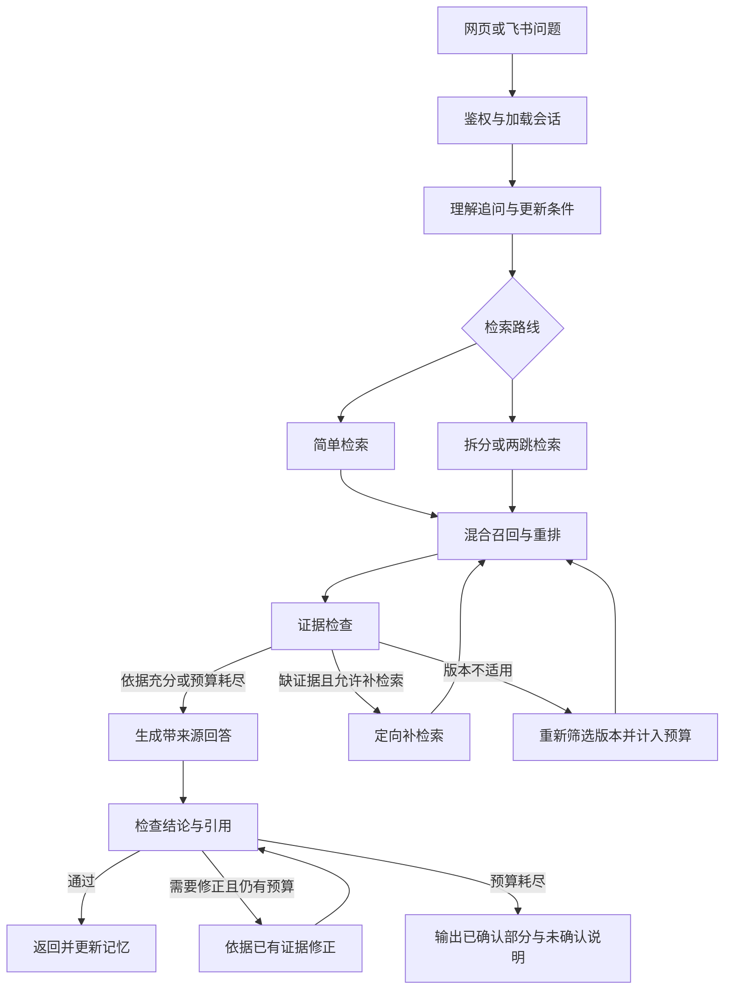

# 电商代运营企业新员工业务知识助手：项目设计方案

更新日期：2026-10-21。用途：求职作品。当前阶段：第一版开发与验证；实际完成情况见《开发与验证记录.md》。

## 1. 项目定位与边界

为虚构的电商代运营企业设计内部知识助手，帮助新员工理解公司服务、岗位职责、项目流程和入职制度。所有公司、客户、流程与制度均为模拟数据。

主要解决两个问题：连续追问遗忘条件；跨文档回答不完整。系统采用 LangGraph 编排有边界的 RAG 工作流，通过分支、多跳检索、证据检查与有限纠错完成问答，不设计自由规划任意任务的通用 Agent。

第一版覆盖：公司服务介绍、部门职责、客户项目启动与交接、日常运营、促销与异常处理、入职与试用期权限。解释经营指标和分析流程，不查询实际店铺经营数据，不执行业务审批或修改客户信息。

入口：Vue 网页和飞书机器人，复用同一套后端问答能力。扣子作为后续扩展。

## 2. 角色与典型业务场景

### 2.1 员工

管理员创建账号，不开放自主注册。资料包括姓名、部门、岗位、入职日期和试用期状态。员工可创建会话、追问、查看自己的历史会话、核对来源、提交反馈与重试失败问题。

预置两个主要演示账号：试用期店铺运营专员、正式客服员工。所有员工可查询相同的已发布知识；岗位与试用期用于判断制度适用性。员工只访问自己的会话，管理员可查看全局记录。

账号资料提供默认身份；“我帮已转正的客服同事问”等表述只覆盖当前事项的问题对象，不修改账号。引用其他人的情况与用户本人的身份应分别存储。

### 2.2 管理员

负责员工账号、文档上传与预览、版本发布和停用、问答记录、反馈，以及 LangSmith 追踪入口。第一版不增加多级审核组织体系。

### 2.3 贯穿演示场景

新运营员工询问：“客户希望下周做促销，我需要准备什么？”随后追问：“我还在试用期，折扣能自己确认吗？”“如果需要投放广告，还要找谁？”系统结合活动流程、审批权限、试用期条款和部门职责回答，并逐项引用。

记忆演示：“我帮已经转正的客服同事问临时活动变更。”经过多轮对话和摘要压缩后追问“他能直接确认吗？”，仍应使用同事的岗位和状态。

## 3. 技术选型

| 模块 | 第一版选择 | 说明 |
|---|---|---|
| 前端 | Vue 3 | 同一工程包含员工端和管理端 |
| 后端 | Python + FastAPI | 账号、文档、会话、问答和飞书接口 |
| 工作流 | LangGraph | 显式状态、条件分支、检查点与恢复 |
| 业务数据库 | PostgreSQL | 账号、会话、文档版本、反馈、请求与运行记录 |
| 检查点 | PostgreSQL 持久化 | 与业务表分开管理，按员工与会话隔离 |
| 文件 | 本地文件目录 | 原始文件和解析产物，不把真实密钥写入设计文档 |
| 向量数据库 | Milvus Standalone | 本地 Docker 部署，HNSW 检索 |
| 关键词召回 | BM25 | 与向量召回融合；具体承载方式实现时按固定 Milvus 版本验证 |
| 生成模型 | deepseek-flash API | 问题理解、拆分、摘要、证据检查和生成共用模型 |
| Embedding | Qwen/Qwen3-Embedding-0.6B，硅基流动 API | 以性价比优先，第一版固定 1024 维 |
| 重排 | BAAI/bge-reranker-v2-m3，本地 Transformers + PyTorch | 仅重排融合候选，默认 CPU，可配置 CUDA；不调用硅基流动重排接口 |
| 追踪 | LangSmith | 关联节点、耗时、调用、重试和失败原因 |
| 运行方式 | 本地运行，使用 Docker | PostgreSQL 与 Milvus 使用独立端口；本地重排权重持久化 |

### 3.1 Embedding 选型依据

用户最新要求以截图中的 Qwen3 Embedding 系列为候选，优先考虑性价比，因此第一版从此前讨论的 BGE-M3 改为 Qwen3-Embedding-0.6B，而不是直接采用截图中选中的 8B。

本项目仅约 15–20 份业务文档，先以小规格模型建立效果基线，再结合 BM25、重排和条款结构优化召回。0.6B、4B、8B 的实际业务优劣必须用相同评估集验证，不能只根据参数量断言。

0.6B 官方模型卡的最大输出维度为 1024；硅基流动接口支持该模型及维度配置。第一版固定 1024 维，文档和查询使用同一模型、维度与预处理策略。更换模型时构建独立索引，重新编码全部文档，验证后切换，不混用旧向量。

0.6B 的 1024 维向量，相对于截图中 8B 的 4096 维配置，原始 float32 向量载荷约为四分之一；这不等于整个数据库或整个索引空间减少四分之三。API 费用、速率和延迟以实际账号服务与测试为准，不把国际站价格作为国内账号报价。

若测试发现语义召回不足，先检查切分、查询表达、版本过滤和候选数量，再用同一评估集对照 4B；第一版不同时维护三套生产索引。

### 3.2 模型调用原则

规则能完成的版本判断、计数、权限校验和预算计算不调用大模型。简单问题走简化分支；复杂问题才拆分和多跳。结构化检查结果至少包含检查项、缺失依据、问题类型和下一步动作。接口能力和输出校验在实现阶段验证。

同一个模型既生成又检查，仍可能共享错误；因此不能把模型自评作为正确性保证，必须结合可回查证据和人工评估。

## 4. 模拟知识库与版本发布

建议先准备 18 份文档：

| 编号 | 文档 |
|---|---|
| BIZ-001 | 公司与代运营服务介绍 |
| BIZ-002 | 服务范围、交付物与承诺边界 |
| ORG-001 | 部门职责与协作关系 |
| JOB-001 | 店铺运营专员岗位说明 |
| JOB-002 | 客服岗位说明 |
| FLOW-001 | 客户项目启动流程 |
| FLOW-002 | 销售到运营的项目交接规范 |
| FLOW-003 | 日常运营与周报流程 |
| FLOW-004 | 促销活动策划与上线流程 |
| FLOW-005 | 广告投放协作流程 |
| FLOW-006 | 活动临时变更与审批流程 |
| FLOW-007 | 客诉与异常升级流程 |
| DATA-001 | 常见经营指标解释 |
| DATA-002 | 报表位置与问题分析指引 |
| HR-001 | 新员工入职与学习指引 |
| HR-002 | 试用期工作与授权规定 |
| AUTH-001 | 运营事项审批权限规定 |
| CONTACT-001 | 业务事项咨询岗位与职责索引 |

其中 HR-002、AUTH-001 至少设计两个版本。文档写明适用范围、条件、例外与生效日期，并使用稳定编号互相引用；不以人为重复堆砌关键词替代真实业务内容。

格式支持 Markdown、DOCX 和可提取文字的 PDF；扫描件暂不支持。模拟资料优先用 Markdown。上传后依次解析、切分、编码、索引、预览和发布，处理失败或未发布内容不进入员工检索。

建议元数据：document_id、version_id、title、section_path、chunk_id、source_location、status、effective_from、effective_to、related_document_ids、content_hash、index_generation。来源位置按格式记录章节、条款、段落或页码，不虚构页码。

发布规则：

1. 同一制度编号的版本独立保留，适用有效期不能重叠。时间区间建议统一为起点包含、终点不包含。
2. 普通问题按当前日期选择版本；历史问题按用户指定日期选择。
3. 仅在新版解析和检索数据准备完成后切换发布状态；新版失败不影响现有版本。
4. 发布切换需要同步关键词和向量检索可见性，后端再次校验候选版本。两者未一致就不宣布发布完成。
5. 停用不等于历史版本自然失效：停用内容退出新检索；已产生的引用保留版本记录，必要时标明已停用。
6. 旧对话引用始终指向原版本，不能悄悄跳转为最新内容。

## 5. 检索与索引设计

处理顺序：明确问题与日期 → 按发布状态和有效期限定候选 → 向量与 BM25 两路召回 → 去重与融合 → 本地 BGE 重排 → 必要章节回取 → 整理证据。

本地重排用 AutoTokenizer 与 AutoModelForSequenceClassification，权重预先下载到 data/models/bge-reranker-v2-m3，运行时离线加载。默认 CPU 对线性层动态 int8 量化以降低常驻内存，词嵌入保留 float32；可切回 fp32 对照排序差异。小批次推理，单进程共享模型并串行控制推理资源。初始 batch_size=4、max_length=512，按机器与测试结果调整；CUDA 环境可配置设备并启用半精度。缺少权重或依赖时明确报错，不静默改为远程 API 或冒充已执行重排。演示模式仍跳过模型推理。

先按标题和完整条款切分，保留所属章节与原文位置；具体长度通过测试调整。不能将适用条件、否定词和例外说明与主体规则任意拆散。章节回取也受证据 token 预算限制，不无条件加载整篇。

融合初步采用 RRF，避免直接相加不同量纲的分数。召回数量、重排数量和最终证据数量均为待测参数。对照实验保持嵌入模型、候选范围和其他配置一致。

### 5.1 HNSW 与 ANN 实验

HNSW 用于近似向量近邻搜索；FLAT 用于精确近邻参考。关注 M、efConstruction 和查询 ef：分别影响图连接、构建候选范围与查询搜索范围。先固定前两项，仅对比几组 ef，避免扩大调参范围。

测量近邻 Recall@K、延迟分布、构建时间和内存。近邻召回的参考集合来自相同过滤条件下的 FLAT；业务证据召回则来自人工标注，两者分别报告。记录数据规模、向量维度、硬件与运行条件。

18 份业务文档可能无法体现 ANN 速度优势；如需扩大规模，另做索引实验集合，与正式问答知识库隔离，不能将复制文档当作新的业务证据。

### 5.2 多跳与拆分

独立子问题可分别检索；只有后一个查询依赖前一个检索结果时才计为依赖多跳。例如先找到“试用期限制及审批角色”，再查该角色的活动审批流程。

最多两跳，即初始检索加一次依赖检索；补检索最多两轮，仅补齐当前两跳任务，不追加第三层依赖。HNSW 的图边不代表业务流程关系，不用于推导审批关系。额外设置总检索调用和总耗时预算，数值测试后确定。

## 6. LangGraph 流程与反思机制

反思检查四项：回答完整性、证据支持、条件适用性和版本适用性。

缺资料则定向补检索；版本错误则筛选适用版本；回答超出证据则修正或删除相关结论；条件不足则说明不同条件下的规则并提示补充。文档冲突不能由模型自行编造优先级，按版本和范围检查后仍冲突就展示冲突与来源。

回答前检查证据覆盖，回答后检查结论与引用。回答修正也设置有限次数，初步一次，仍失败则返回可确认的部分。补检索、生成修正和技术重试共同受总预算约束。

员工只看到答案和来源，不展示内部检查详情。若文档未提供负责岗位，不编造联系人。

## 7. 上下文压缩与记忆管理

| 层次 | 内容与规则 |
|---|---|
| 账号资料 | 登录加载；只读默认身份，聊天不自动修改 |
| 当前事项条件 | 问题对象、岗位、试用期、客户事项、日期、限制及原始消息引用 |
| 最近对话 | 默认保留最近 4 轮，一轮为一次提问与回答，仍受 token 上限限制 |
| 较早历史摘要 | 对话记忆占分配预算约 70% 时触发，压缩较早部分 |
| 原始记录 | 完整保存在数据库，支持关键词或语义辅助回查，严格限制员工和会话范围 |
| 历史证据引用 | 保留文档与版本标识，需要时重取并检查适用性 |

70% 指分配给对话记忆的预算，不是模型总窗口。系统指令、当前问题、结构化条件、检索证据和回答输出另有预留。4 轮和 70% 均为初始配置，真实测试后调整。

摘要不能代替关键事实。用户纠正条件时更新当前值并保留变更来源；无法确认是纠正还是另一个对象时，不盲目覆盖。摘要优先记录已讨论事项、已确认结论、未解决问题和来源标识，不把无依据的历史回答升级为事实。

切换话题时归档旧事项条件，保留身份；明确回到旧话题时恢复。新会话只加载账号资料，不自动继承旧会话摘要或事项条件。

遇到指代不清、条件冲突、用户说“前面提过”或摘要不足时回查原始消息；仍不能确认则说明条件分支或请用户补充。不承诺能自动发现所有遗漏，用压缩前后和话题切换案例验证。

摘要更新绑定已处理的消息边界，失败时保留旧摘要与原始记录，不先删除旧内容。

## 8. 检查点、重试与幂等

关键节点完成后保存流程状态，包括请求、员工、会话、图执行标识、问题与条件、子问题、证据及版本、计数、生成阶段和运行配置。具体字段以实现采用的 LangGraph 版本为准。

三类机制分开：

- 技术重试：模型或数据库临时超时等可恢复错误，最多额外两次，等待逐步增加。参数错误、无权限、密钥错误不进行同样重试。
- 业务补检索：调用成功但证据不足，最多两轮。
- 中断恢复：进程重启后恢复同一次请求，优先复用有效已完成阶段。

员工点击“重试本次问题”时，根据请求编号检查状态；正在执行则返回已有任务状态，成功则返回原结果，失败或中断才恢复。相同请求不重复写入回答和反馈。并发执行需要占用控制，避免同一个检查点被两个执行同时推进。

恢复时检查相关文档版本、发布状态和索引代次。失效则保留问题理解结果，清除不再适用的证据和草稿，重新检索。尚未返回的草稿不作为最终答案展示。

LangSmith 是观察与排障入口，不能代替业务数据库或持久化检查点。

## 9. 页面、飞书与追踪

员工端：登录、会话列表、聊天、引用侧栏、查看全文、反馈和失败重试。侧栏展示原版本条款、文档名和适用日期；如果关联全文，仍定位到原版本。

管理员端：员工管理、文档处理与预览、发布与停用、版本记录、问答列表、反馈、运行摘要、LangSmith 追踪入口。业务后台不能简单替换为 LangSmith 页面。

飞书：身份绑定企业员工账号后调用相同问答服务，按会话规则隔离记录；先支持私聊问答和来源链接。入口事件按事件编号去重。若采用事件长连接，可先在本地验证，不默认要求公网回调；具体连接方式实现前核验平台要求。来源链接的可达性与员工登录状态单独验证，不能仅返回飞书无法访问的 localhost 链接。

追踪关联 request_id、conversation_id、graph_run_id 和 trace_id，记录路线、查询、候选标识、文档版本、检查结论、重试原因、耗时和 token。只保存任务需要的诊断信息，不记录 API 密钥，也不要求展示模型内部思维过程。

反馈：有帮助/无帮助及可选原因。先供管理员分析和扩充评估集，不自动修改制度或模型记忆。

## 10. 数据存储职责

| 存储 | 数据 |
|---|---|
| PostgreSQL 业务表 | 员工、会话、消息、事项条件、摘要、文档与版本、处理任务、请求、反馈、发布与运行记录 |
| PostgreSQL 检查点表 | 工作流快照与恢复所需状态，与业务表分开 |
| 本地文件目录 | 原始文件、解析文本等可回查产物 |
| Milvus | 稠密向量及必要过滤元数据；关键词索引实现按锁定版本验证 |
| LangSmith | 调用和工作流诊断追踪，关联到业务记录 |

PostgreSQL 中的发布状态和版本信息作为业务依据；Milvus 是可重建的检索数据。删除或重新索引文档时不能破坏已有回答的来源记录。

密钥由用户在本地.env维护，分别配置 DeepSeek、硅基流动、LangSmith、飞书和数据库连接，不写入源码或诊断输出。当前DeepSeek与国际站Embedding已完成真实接入，具体状态见《开发与验证记录.md》；公司与员工资料仍为模拟数据。

## 11. 评估与验收

准备 30 个业务案例，每类约 6 个：

1. 基础检索：服务范围、岗位职责、业务指标和流程入口。
2. 跨文档与多跳：权限加审批角色、项目交接加岗位职责、活动加广告协作等。
3. 多轮与压缩：条件保持、问题对象覆盖、纠正、4 轮窗口之外回查、话题切换与返回。
4. 版本适用：当前、历史日期、生效边界、指定旧版本及有效版本缺失。
5. 证据不足与纠错：部分问题无依据、文档冲突、错误候选、条件不足和预算耗尽。

每例记录账号、完整输入对话、适用日期、期望要点、必要来源和禁止出现的错误。多轮案例包含完整对话序列，不计作单句问题。开发调试案例与最终留出案例分开；失败案例可回归，但不能把调参后同一套数据的结果当作独立泛化证明。

指标：人工评估正确与完整情况、关键结论引用支持、条件保留、版本选择、无依据结论，以及延迟、调用次数和 token。模型评分只作辅助。先取得基线再设目标，不预先填写虚构准确率。

对照组：

- 普通单次检索 vs 多跳、补检索与反思流程。
- 仅最近 4 轮 vs 最近 4 轮、关键条件、摘要与回查。
- 少量相同问题关闭反思，观察其修正收益和额外成本。
- HNSW vs FLAT 的索引实验另行报告。

故障演示：临时超时触发有限重试；中途进程退出后恢复；中断期间制度更新后重新检索。以故障注入测试，不需要依靠真实服务随机故障。

## 12. 实施顺序与尚待实测参数

1. 编写模拟文档、版本关系与参考案例，先验证业务和证据链合理。
2. 完成账号、文档解析发布、基础检索、引用展示与普通问答。
3. 接入 LangGraph 分支、多跳、证据检查和有限补检索。
4. 加入结构化条件、摘要、历史回查和话题切换。
5. 加入持久化检查点、技术重试、幂等与管理员追踪。
6. 接入飞书，完成业务评估、效果对比与故障演示。
7. 单独进行 ANN 参数实验，整理结果、演示脚本和项目说明。

后续需实测：电脑内存及 Docker 资源、固定依赖版本、模型账号可用性与费用、切分长度、召回数量、HNSW 参数、总执行预算、token 预算和摘要阈值。现阶段不因此扩大为生产级平台。

## 上下文分级压缩实现补充（2026-10-21）

实现位置为 `backend/app/compression.py`，由 `Models.json` 在每次生成模型调用前统一执行，因此问题理解、证据检查、查询改写、回答、核验和增量摘要均受预算约束，不额外改变已有 LangGraph 路由。

默认总预算 16000，扣除输出预留 2400 和安全余量 800，输入预算 12800；使用可配置阈值 50% / 70% / 85%。第一层对完整段落去重和清理内部元数据；第二层按相关性抽取证据、收紧窗口并创建带消息编号的抽取摘要；第三层重建更紧凑的工作上下文，并按完整段落处理超长近期消息。每层后重新估算，未超阈值则不进入下一层。

当前问题、结构化身份及事实、查询日期、已有答案不被裁剪；片段 ID、文档版本、有效期和引用编号不变。压缩只影响请求副本，数据库及检查点保存原文，支持按 ID 回查。增量摘要逐字校验受保护条件，失败后保留旧摘要。必要内容仍超预算时停止请求并保留可恢复状态。保护规则仍需针对真实业务语言持续评测，不能据此声称所有条件永不遗漏。

使用 UTF-8 长度估算 Token，实际 API 用量单独记录，当前不声明精确分词或模型容量。验证入口为 `backend/tests/test_compression.py` 和无模型调用的 `python -m scripts.context_compression_demo`；运行记录中增加 memory_context / context_compression 事件。

## 13. 参考资料

- [All-in-RAG 教程与项目](https://github.com/datawhalechina/all-in-rag)：基础流程、数据、索引、混合检索与评估参考。
- [DeepSeek API 官方接入文档](https://api-docs.deepseek.com/quick_start/pricing-details-cny/)：核对 deepseek-flash 模型标识。
- [硅基流动 Embedding 接口](https://docs.siliconflow.cn/docs/api/embeddings-post)：核对 Qwen3 系列模型与维度配置。
- [Qwen3-Embedding-0.6B 官方模型卡](https://huggingface.co/Qwen/Qwen3-Embedding-0.6B)：模型能力、维度和使用方式。
- [BGE Reranker 官方模型卡](https://huggingface.co/BAAI/bge-reranker-v2-m3)：本地 Transformers 推理参考。
- [Milvus HNSW](https://milvus.io/docs/hnsw.md)：算法与参数取舍。
- [Milvus Standalone Docker 部署](https://milvus.io/docs/install_standalone-docker.md)：部署参考；实现时固定兼容版本。

以上为设计参考，不代表已经完成接入、测试或性能验证。
